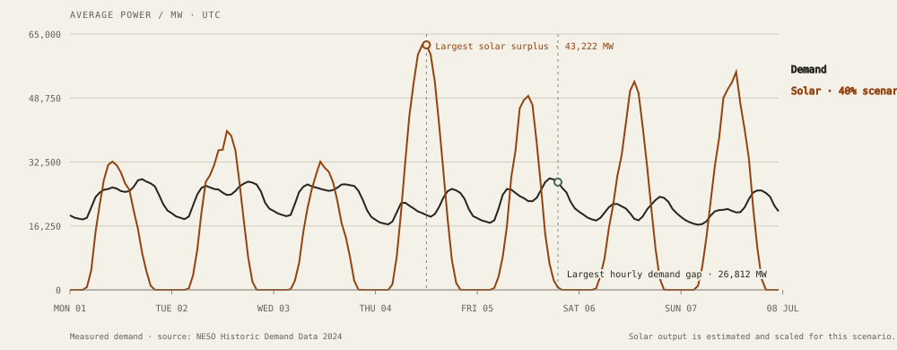

# BatteryWise

**When does a battery help a solar-heavy grid?** BatteryWise is an open, reproducible hourly storage simulator using Great Britain’s 2024 grid data. Demand comes from NESO’s National Demand series; embedded solar is explicitly labelled as NESO’s estimate.



The workbench compares no storage with small, medium, large and custom batteries; plots hourly demand, solar, residual demand and state of charge; reports losses and equivalent full cycles; and shows the additional solar delivered per added capacity. The solar share, capacity, power, efficiencies and state-of-charge limits are editable.

## Run the website

https://illmaahh.github.io/batterywise/

Open `web/index.html` directly, or serve the folder locally:

```sh
cd web
python -m http.server 8000
```

For a production folder, run `node web/build.mjs`. It writes `web/dist/` using Node’s built-in file utilities. The site has no runtime API calls or third-party front-end dependencies. `vercel.json` is configured to publish this static output.

## Reproduce the data

Download the NESO 2024 CSV listed in [DATA.md](DATA.md) to `data/raw/demanddata_2024.csv`, then run `python scripts/process_neso.py`. The script checks settlement periods against Europe/London daylight-saving rules and creates the browser dataset. Source, licence, units, data quality and conversion are documented in [DATA.md](DATA.md). Solar is scaled to a chosen share of annual demand; the default 40% is a scenario assumption, not a forecast.

## Model and checks

The pure Python reference is in `batterywise/simulation.py`; the browser implementation is `web/model.js`. Both use the same greedy hourly dispatch and golden fixture. Results expose curtailment, residual demand, losses, solar served, state of charge and equivalent full cycles. See [ASSUMPTIONS.md](ASSUMPTIONS.md) for formulas and limits.

Run the checks:

```sh
python -m pip install -e .[test]
python -m pytest
cd web && node --test ../tests/web_model.test.cjs && node build.mjs
```

A six-item contribution roadmap is on the [website](web/index.html#good-first-issues) and in [docs/good-first-issues.md](docs/good-first-issues.md). The project is licensed under MIT.

## Deploy with GitHub Pages

The repository includes a GitHub Actions workflow that builds `web/dist` and publishes it on every push to `main`. GitHub Pages is configured to deploy through Actions. Visit the live site at [illmaahh.github.io/batterywise](https://illmaahh.github.io/batterywise/).
